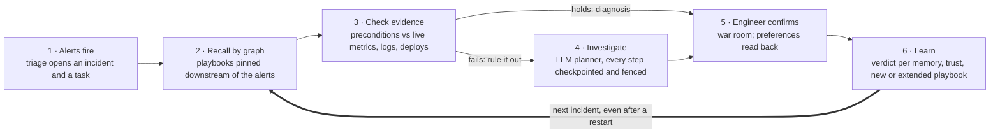
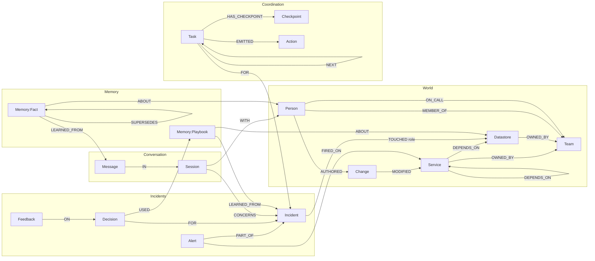
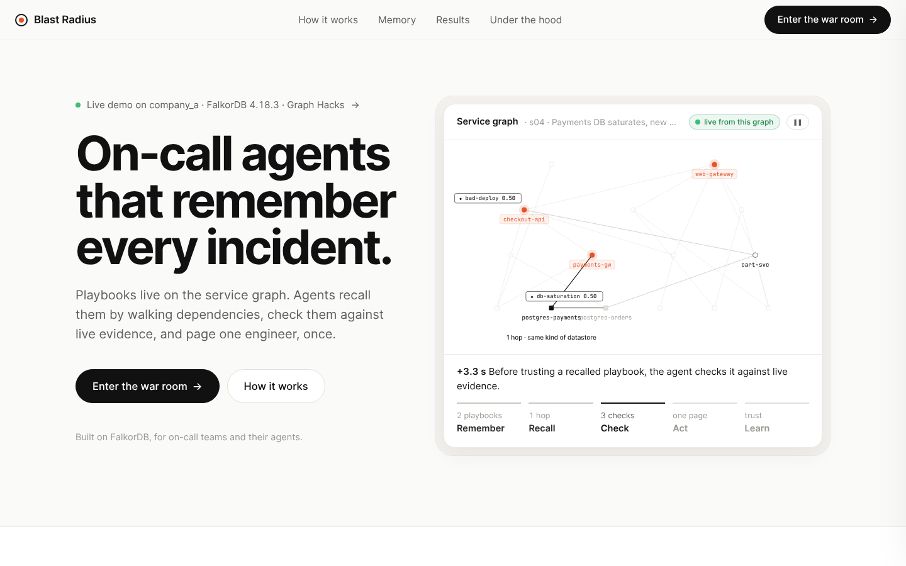

# Blast Radius

**On-call agents that remember previous incidents, check whether that memory still applies, and show how it changed the next investigation, even after a restart.**

Built for Graph Hacks 2026 on FalkorDB by team **Blastproof** (sri ram, Aditi Akansha). Tracks: **Agent Memory and Coordination** (primary) and **Agents That Act on Connected Data**: the agents act through multi-hop graph queries, also served over MCP. FalkorDB holds the agents' memory, the shared task state they coordinate through, the conversation history and the evidence trail. Take it out and nothing works: the UI refuses to start without it, and the agents pause until it is back.


*The war room during demo moment 4, live (deterministic planner, demo timing). inv-2 was SIGKILLed after step 3; inv-1 took over at step 4 under epoch 2, not from scratch. The playbook learned on `postgres-orders` was recalled for `postgres-payments` (one hop, same kind of datastore, the dashed line) and is being checked against live evidence; the left column is the Memory Lens. Every element is read from FalkorDB.*

**Read the write-up:** [Teaching on-call agents to remember](https://genziitian.github.io/Blastproof/blog/), what we built, how it works and what we learned (also served locally at `/blog/` by `make ui`; source in [`docs/blog/`](docs/blog/)). Read it in English, Français, עברית, हिन्दी, Español or اردو, or any other language Chrome can translate on your device: [`?lang=hi`](https://genziitian.github.io/Blastproof/blog/?lang=hi).

## Contents

[The idea](#the-idea) · [Track 02](#track-02-what-it-asks-and-where-we-do-it) · [Results](#results) · [How memory works](#how-memory-works) · [Crash safety](#crash-safety-and-coordination) · [Graph data model](#graph-data-model) · [Queries](#queries) · [FalkorDB findings](#falkordb-findings) · [Run it](#run-it) · [Limits](#limits-and-what-didnt-work) · [AI assistance](#ai-assistance)

## The idea

When an incident is confirmed, its investigation becomes a **playbook** pinned to the failing node in the company's dependency graph: what to rule out first, what to expect, and where it came from. The next time alerts fire, agents recall the playbooks pinned **near the alerting services in the graph**, check each against live evidence before trusting it, and investigate from scratch only if none holds. Memory that misleads loses trust and retires. What engineers say in the war room ("for DB saturation, open a ticket with the raw lines") becomes a sourced, conditional preference that changes the next notification. All of it survives restarts, and a worker can die mid-investigation without anything being done twice.



## Track 02: what it asks and where we do it

> *"Build agents that remember across sessions and share state with each other. Memory should persist, update over time, and be available to every agent that needs it."*

| Focus point | Feature | Proof |
|---|---|---|
| Episodic, semantic, procedural memory | Incidents, checkpoints and immutable decisions; time-valid preference facts; playbooks with machine-checked preconditions | Eval M1–M5; Memory Lens |
| Persistent conversation history | War room: verbatim messages per engineer and incident, read-back before saving, preferences cited later, earlier sessions shown | Acceptance check 6 after a full restart; `tests/test_g2_live.py` |
| Shared state and handoffs | Fenced tasks in the graph: investigator → responder → learner, derived-id handoffs, intent-keyed actions | Acceptance checks 4–7 with a real SIGKILL; agent timeline |
| High-concurrency reads and writes | Two companies, every agent in its own claim loop, leases expired at random | `make bench`: 0 duplicate notifications |
| Separate memory per user or tenant | One graph per company; per-engineer preferences; no tool takes a graph argument | `make isolation`; the UI API test; canary search: 0 found |
| Persist, update over time | RDB snapshots + restart test; trust moves on verdicts; facts superseded, never edited; a wrong playbook retires | Acceptance part 1 → restart → part 2; M5 |

## Results

A 30-incident synthetic benchmark replayed in time order. Three setups, each in its own graph, with the same model (Claude Haiku 5.5), tools, step budget (12), oracle and learning; **only how memories are retrieved differs**:

- **A, no memory:** always investigates from scratch.
- **B, text memory:** tries the memories whose text is most similar to the alerts (embedding similarity, FalkorDB `vec.cosineDistance`).
- **C, graph memory:** tries the memories pinned near the alerting services in the dependency graph.

Frozen run on Oct 16 from the submitted code (`eval/results/2026-10-16T14-24-13Z-claude-haiku-5-5/`, uncached, 0 model failures):

| | A: no memory | B: text memory | C: graph memory |
|---|---|---|---|
| Root cause correct | 30/30 | 29/30 | **30/30** |
| LLM requests, whole benchmark | 192 | 107 (−44%) | **55 (−71%)** |
| Input / output tokens | 456k / 62k | 266k / 34k | **133k / 18k** |
| Wall-clock time, whole benchmark | 433 s | 241 s | **125 s** |
| Incidents solved with no model call | 0 | 10 | **20** |
| Repeat incidents: LLM requests, seconds each | 6.0, 13.3 s | 1.7, 3.6 s | **0, 0.02 s** |
| Related-service incidents: LLM requests, seconds each | 5.8, 12.4 s | 2.7, 5.7 s | **0, 0.02 s** |
| Same symptom, different cause: LLM requests, seconds each | 6.5, 15.0 s | 3.2, 7.7 s | **0.8, 1.7 s** |
| Recall@5 of a memory that gives the right answer (20 incidents where one exists, same snapshot) | n/a | 55% | **100%** |
| Times a memory misled the agent | n/a | 0 | 0 |
| Right person paged after an on-call or ownership change | 3/3 | 3/3 | 3/3 |
| Duplicate notifications | 0 | 0 | 0 |
| M5: a deliberately wrong playbook | n/a | n/a | misled twice, retired, next incident correct |

Approximate model cost for the whole benchmark: A $0.04, B $0.02, C $0.01 (most input tokens are prompt-cache reads). An earlier run on Oct 15, before the UI work, gave nearly the same picture: 185 / 101 / 52 model requests, 30 / 29 / 30 correct, recall@5 48% vs 100% (in `eval/results/` too).

What this does and doesn't show:

- **Same accuracy, far less work.** Claude Haiku 5.5 already solves this benchmark from scratch, so memory can't raise accuracy here. Graph memory gives the same answers with 71% fewer model requests, and with no model call at all for 20 of 30 incidents.
- **Text memory finds the right memory about half as often.** When a memory that gives the right answer exists, text similarity ranks it in the top 5 for 55% of incidents (48% in the earlier run), graph proximity for 100%: "which node is failing near these alerts" is a question about the dependency graph, not about wording.
- **Checking the wrong memories has a cost.** Every recalled memory is checked against live evidence before it is trusted, so no arm was ever misled; but checks take steps. Arm B lost one incident (e20, in both runs) this way: it checked five wrong memories, and the model ran out of the 12-step budget. On cold and novel incidents, graph memory also takes more steps than no memory (about 8 vs 6), though fewer model calls.
- **Caveat on B:** text is embedded with a deterministic hashed bag of words; a neural embedder (`EMBED_MODEL`) is supported and would be a fairer opponent.
- **Synthetic benchmark only.** A 15-node company and three failure families; the results describe this benchmark and nothing more. The same run with the deterministic planner (no model) is in `eval/results/` too: 30/30 in every arm, repeat/related steps A 6.2/5.3, B 7.3/8.0, C 3.0/4.8.

### Concurrency and tenant isolation (M8, M9)

Two companies, every agent in its own claim loop, 20 incidents fired at once, FalkorDB in Docker on one laptop, deterministic planner (this measures FalkorDB and the coordination protocol, not a model). `make bench`, `make isolation`.

| Worker pairs per company | Stalled workers | Done | Incidents / min | Memory reads p50 / p95 | Memory writes p50 / p95 | Duplicate notifications | Takeovers |
|---|---|---|---|---|---|---|---|
| 1 | none | 20/20 | 6,633 | 0.35 / 0.81 ms | 0.33 / 1.01 ms | 0 | 0 |
| 2 | none | 20/20 | 9,185 | 0.61 / 1.54 ms | 0.63 / 1.82 ms | 0 | 0 |
| 4 | none | 20/20 | 9,062 | 0.87 / 2.00 ms | 1.22 / 3.20 ms | 0 | 0 |
| 4 | a held lease expired every 50 ms | 20/20 | 8,712 | 0.71 / 1.86 ms | 0.91 / 2.58 ms | **0** | 1 |

One run on Oct 16 (`bench/results/load.json`), FalkorDB 4.22.1 with RDB snapshots on a MacBook Air. Throughput levels off beyond 2 pairs: FalkorDB runs one graph's writes one at a time, and every agent step is a short write. Earlier runs with the append-only file (fsync every second) were about 3× slower (≈2,000–3,100 incidents/min, p50 ≈2–3 ms), with the same zero duplicates. With stalled workers, another worker takes the task over and the stalled one's next write is rejected by the fence (here 1 takeover; at this speed most incidents finish between chaos ticks, and slower runs saw 6–7). Nothing is ever sent twice.

Isolation: identical service names, keys and incident ids in both companies; every stored string in each graph, and every UI API response, is searched for the other company's canary and people: 0 found.

## How memory works

1. **Triage** turns alerts into an `Incident` and an `investigate` task.
2. **Investigator** recalls playbooks pinned near the alerting services (A1, A1b) and records what it recalled before checking anything. It checks each against live evidence without the model; the first whose preconditions and expected observations all hold is the diagnosis. Otherwise it investigates with the LLM planner, guard-railed by a rule-based planner. Every tool call is checkpointed before the next one.
3. **Responder** notifies whoever owns the failing node and is on call *at the incident's time*, the way that person asked for this kind of incident, citing the message where they asked. What the engineer says is stored verbatim; instructions become approved preferences only after a read-back and a yes.
4. **Learner** gives each memory used a verdict, updates trust, retires memories that keep misleading, and turns a confirmed investigation into a sourced playbook, or adds the new incident as a source of an existing one.

The `Decision` and its `USED` edges record every memory considered, with the evidence for and against, so "what did the agent believe then, and why?" is a query, not a guess. That is what the Memory Lens shows:


| | Algorithm | Where |
|---|---|---|
| A1 | **Graph recall, downstream only, with paths.** Playbooks `ABOUT` a node 0–2 `DEPENDS_ON` hops downstream of an alerting service. Score = trust × e^(−age / 30 days) × Σ over alerting services of 0.5^hops; top 5 with their paths. | `memory/queries/recall*.cypher`, `memory/recall.py` |
| A1b | **Kind transfer.** Playbooks learned on another datastore of the same kind (any `postgres`), at half weight. | `memory/queries/recall_kind.cypher` |
| A2 | **Trust from per-memory verdicts:** helped (followed and right), misled (followed and wrong), not applicable (a precondition failed; no change). trust = (helped + α) / (helped + misled + α + β), agent prior 1/1, human prior 2/1. Retire when misled ≥ 2 and trust < 0.5. | `memory/queries/feedback.cypher` |
| A3 | **Facts change by supersession, never by edit.** Validate first, then create one new version that closes the old one's `valid_to`; conditional lineage, so "DB saturation → ticket" and "bad deploy → page" coexist. | `memory/queries/fact_*.cypher` |
| A4 | **Candidate playbook from a confirmed run:** the rule-outs that held and the observation that confirmed the cause, parameterised (`$alerting`, `$caller`, `$target`), machine-checkable, with a stop rule. | `memory/templates.py`, `memory/queries/write_playbook.cypher` |
| Org | On-call and ownership changes close the old edge and open a new one, so `who_to_page` is right for any moment. | `sim/queries/` |

## Crash safety and coordination

FalkorDB makes each query atomic; the agents add three rules on top:

- **Fence every task write.** Claims start a new epoch using the database clock; every write checks status, epoch, owner and `lease_until >= timestamp()`, and returns `ok`, `already_done` or `lease_lost`. A worker that lost its lease stops at once.
- **Checkpoint synchronously.** Each tool call is written before the next starts. A replacement worker reads the checkpoints and continues at step n + 1.
- **Key every action by intent.** `incident:<id>:initial-notification` is sent once, whoever sends it; the recipient is fixed at the first write.

Plus derived-id handoffs, an attempts limit and a stuck sweep. The acceptance test SIGKILLs a real worker process after checkpoint 3, after a full `docker compose down && up`; the replacement resumes at step 4 under epoch 2, and exactly one notification goes out.

## Graph data model

One graph per company (`company_a`, `company_b`), identical in shape. Read off a populated graph:



**Nodes**

| Label | Layer | Key properties |
|---|---|---|
| `Service`, `Datastore` | World | `key`, `name`, `tier`, `customer_facing`; datastores `kind` (postgres, redis, kafka) |
| `Team`, `Person` | World | `key`, `name`, `channel`; `handle` |
| `Change` | World | `key`, `kind` (deploy, config), `at`, `summary` |
| `Alert` | Incident | `key`, `signal`, `text`, `fired_at` |
| `Incident` | Episodic | `key`, `id`, `status`, `observed_at`, `opened_at`, `resolved_at`, `signature` (family + root kind, set on confirm) |
| `Decision` | Audit, immutable | `id`, `kind`, `root`, `family`, `summary`, `evidence_steps`, `agent`, `task_id`, `epoch` |
| `Feedback` | Incident | `id` (stable), `verdict`, `by`, `at` |
| `Memory:Playbook` | Procedural | `signature`, `family`, `applies_to_kind`, `params_json`, `preconditions_json`, `steps_json`, `conclusion`, `stop_if`, `payload_hash` + shared memory fields |
| `Memory:Fact` | Semantic | `subject`, `predicate`, `condition_family`, `object`, `approved_by` + shared memory fields |
| `Session`, `Message` | Conversation | `id`, `started_at`; `key`, `role`, `text`, `seq`, `at` |
| `Task` | Coordination | `id`, `type`, `status`, `epoch`, `attempts`, `lease_owner`, `lease_until`, `claimed_by[]`, `claimed_at[]`, `recalled_json` |
| `Checkpoint` | Coordination | `cid` (task + n), `n`, `epoch`, `agent`, `tool`, `args_json`, `observation`, `at`, `scenario_at` |
| `Action` | Coordination | `key` (intent), `kind`, `recipient`, `channel`, `payload`, `status`, `sent_at` |
| `Canary` | Isolation test | `value` (per company) |

Shared memory fields: `id`, `lineage_id`, `version`, `source` (agent or human), `valid_from`, `valid_to` (absent means open-ended), `recorded_at`, `status` (active, retired), `helped`, `misled`, `prior_a`, `prior_b`, `trust`. FalkorDB can't store maps, so nested playbook parts are validated JSON strings.

**Edges**

| Type | From → to | Properties |
|---|---|---|
| `DEPENDS_ON` | Service → Service, Datastore | |
| `OWNED_BY`, `ON_CALL`, `MEMBER_OF` | Service/Datastore → Team; Person → Team | `valid_from`, `valid_to`: closed and reopened, never edited |
| `AUTHORED`, `MODIFIED` | Person → Change → Service | deploy history |
| `FIRED_ON`, `PART_OF` | Alert → Service; Alert → Incident | |
| `TOUCHED` | Incident → Service, Datastore | `role`: alerting, root |
| `FOR` | Task, Decision → Incident | |
| `HAS_CHECKPOINT`, `NEXT`, `EMITTED` | Task → Checkpoint, Task, Action | |
| `ABOUT` | Memory → Service, Datastore, Person | where a memory applies |
| `LEARNED_FROM` | Memory → Incident, Message | provenance |
| `SUPERSEDES` | Fact → Fact | new version → old |
| `USED` | Decision → Memory | `target`, `score`, `hops`, `path`, `trust_at_use`, `applied`, `checks_json`, `verdict` (set once), `trust_after` |
| `ON` | Feedback → Decision | |
| `WITH`, `CONCERNS`, `IN` | Session → Person, Incident; Message → Session | |

**Indexes and constraints** (`make schema`): unique on `Memory.id`, `Task.id`, `Decision.id`, `Action.key`, `Feedback.id`, `Checkpoint.cid`, `Session.id`, `Message.key`, `Incident.key`, `Alert.key`, `Change.key` and the world nodes' `key`; plain indexes on `Service.name`, `Task.status`, `Task.type`, `Memory.lineage_id`, `Playbook.signature`, `Incident.status`. Constraints are polled until `OPERATIONAL` before any worker starts.

**Rules the code keeps:**
- **One graph per company**, chosen from trusted config, never by the model.
- **Two clocks:** `timestamp()` inside queries for leases; scenario time for evidence, validity and `recorded_at`, so a replayed incident never sees memory from its future.
- **Memory is never edited:** facts are superseded, playbooks gain sources, trust moves only on verdicts.
- **Ground truth lives only in `eval/truth/`.** `tests/test_boundaries.py` fails if agent-side code imports it.

## Queries

All 73 queries are `.cypher` files, indexed with what each does in **[`docs/QUERIES.md`](docs/QUERIES.md)** (generated from the files; a test keeps it current). In the UI, the **{ } query** button on each part opens the queries behind it. The ones the product depends on most:

| Query | Does |
|---|---|
| [`memory/queries/recall.cypher`](memory/queries/recall.cypher) | A1: playbooks 1–2 hops downstream of the alerting services, with paths |
| [`memory/queries/recall_kind.cypher`](memory/queries/recall_kind.cypher) | A1b: playbooks learned on another datastore of the same kind |
| [`memory/queries/feedback.cypher`](memory/queries/feedback.cypher) | A2: one verdict per `USED` edge, trust and retirement |
| [`memory/queries/fact_supersede.cypher`](memory/queries/fact_supersede.cypher) | A3: a new fact version that closes the old one |
| [`memory/queries/write_playbook.cypher`](memory/queries/write_playbook.cypher) | A4: a sourced candidate playbook |
| [`coord/queries/claim.cypher`](coord/queries/claim.cypher) | Claim the oldest claimable task, new fencing epoch, database clock |
| [`coord/queries/checkpoint.cypher`](coord/queries/checkpoint.cypher) | Fenced, idempotent checkpoint |
| [`coord/queries/send_action.cypher`](coord/queries/send_action.cypher) | Send once per intent, report `already_done` on retry |
| [`agents/queries/confirm.cypher`](agents/queries/confirm.cypher) | One write: feedback, resolve the incident, queue learning |
| [`chat/queries/preferences_for.cypher`](chat/queries/preferences_for.cypher) | Preferences in force at incident time, with the message they came from |
| [`tools/queries/who_to_page.cypher`](tools/queries/who_to_page.cypher) | Owner and on-call *at scenario time* |
| [`tools/queries/upstream_candidates.cypher`](tools/queries/upstream_candidates.cypher) | Shared downstream dependencies of the alerting services |

## FalkorDB findings

Details and reproductions in [`docs/FALKORDB-FINDINGS.md`](docs/FALKORDB-FINDINGS.md):

- **AOF replay diverged on 4.22.1** after a day of graph deletes and re-creates (`GRAPH.EFFECT references label/relationship-type 'Memory' (id 0) which doesn't match local schema state`), and the server shut itself down on every start. We persist with RDB snapshots instead; the restart test passes.
- **Each unique-constraint creation is written to the AOF three times** (28 commands, 84 entries), and replay logs `Constraint already exists` errors (4.18.3).
- **A later `SET` clause reads the values from before an earlier `SET` clause** (`SET m.h = m.h + 1 SET m.t = m.h` leaves `t` at the old `h`); a `WITH` between them fixes it. This silently broke our trust update until a FalkorDB run caught it.

## Run it

Requires Docker and Python 3.10+. Run everything from this folder. Tested on macOS and on Windows 11; on Linux the same commands apply.

```bash
python3 -m venv .venv && source .venv/bin/activate
make install
cp .env.example .env     # settings are read from .env automatically

make db          # FalkorDB 4.22.1, pinned by digest (Browser on http://localhost:3000)
make schema      # indexes + unique constraints; waits until all are OPERATIONAL
make seed        # explicit; nothing reseeds on startup
make ui          # http://localhost:8000 (landing page), /mission-control (the live demo), /blog/ (the write-up)
```



If something else already listens on port 6379 (a local Redis), set `FALKORDB_PORT=6380` in `.env`; Docker Compose and the Python client both read it.

**On Windows** the `make` targets need Git Bash (or WSL). From PowerShell, the same steps are: `python -m venv .venv`, `.venv\Scripts\activate`, `pip install -r requirements.txt`, `copy .env.example .env`, `docker compose up -d falkordb`, `python -m scripts.setup_schema`, `python -m scripts.seed`, then `$env:TIMING_PROFILE='demo'; python -m web.app --company a`.

**The UI** has two pages. The **landing page** (`/`) explains the idea with live data: its hero replays a real incident from the graph, and every number, check and playbook on it is read from the API (a labelled recorded run stands in until this machine has run its own). **Mission control** (`/mission-control`) is the live demo: it runs two investigators as separate processes (Kill sends a real SIGKILL), plus the responder and learner, and reads everything back from FalkorDB. You play the on-call engineer in the war room, or switch on "scripted engineer" in Director. Each incident is told as the learning loop, step by step, every animation driven by a real event in the graph, and **← ▶ →** replays any incident from its stored steps. `/dark` and `/classic` keep the earlier views. Demo timing (6 s lease, 2 s heartbeat; production 30 s / 10 s) is labelled on screen. Panels and the demo walkthrough: [`web/README.md`](web/README.md).

**The acceptance test** (seven checks, real process kill, full restart):

```bash
make acceptance-1      # resets company_a, runs s01, learns a playbook
docker compose down && docker compose up -d falkordb
make acceptance-2      # s04 after the restart, SIGKILL mid-investigation, takeover
```

**Persistence:** FalkorDB writes an RDB snapshot every 30 s if anything changed and on every shutdown, into a named Docker volume. `make acceptance-2` and the UI wait until FalkorDB has finished loading after a restart. If FalkorDB goes away while the UI runs, the agents log one line and wait, and the page shows a banner until it's back.

**Benchmarks and tests:**

```bash
make test        # every suite on the in-memory graph double (offline)
make test-live   # the integration suites on FalkorDB too
make eval-rules  # arms A, B, C with the deterministic planner, no model calls
make eval        # arms A, B, C with the configured model; eval/results/<timestamp>/
make bench       # concurrency with 1, 2 and 4 worker pairs, then with stalled workers
make isolation   # tenant isolation
make story       # s01 -> s04 -> s05 in the terminal
```

The integration suites are written once and run on two backends: FalkorDB when it is reachable, and `tests/graph_double.py` always. The double runs each query's Python twin and checks every call against the real `.cypher` file (parameters, RETURN columns, property types). Only FalkorDB proves the Cypher itself, and it caught what the double could not (the `SET` finding above). The double lives in `tests/` and only tests use it: the UI, workers, eval, benchmark and acceptance test all connect to FalkorDB, and a test fails if product code imports anything from `tests/`.

**Model.** Everything runs without a model (rule-based planner and preference parser). With a model, the investigator plans with it and the war room reads the engineer's messages with it; any invalid answer falls back to the rule-based step.
- **Claude** (what the results use): `LLM_BASE_URL=https://api.anthropic.com`, `LLM_MODEL=claude-haiku-5-5`, `LLM_API_KEY=...`. Native Messages API with prompt caching: tools, instructions and earlier steps are re-read from cache on each turn.
- **Any OpenAI-compatible endpoint** (Gemini, DeepSeek, Groq, OpenAI, Ollama): set base URL, model and key; see `.env.example`.

**MCP.** `python -m tools.mcp_server --company a --scenario s01` serves the agents' seven tools (four multi-hop graph queries, three evidence tools) to any MCP client. `tests/test_mcp.py` runs a real client session against it.

### Layout

| Path | Contents |
| --- | --- |
| `agents/` | Worker loop, triage, planners, investigator, responder, learner |
| `memory/` | Recall, playbooks, templates, verdicts, fact writes, and their queries |
| `chat/` | War-room sessions, preference extraction, recap |
| `coord/` | Fenced task coordination and its queries |
| `tools/` | Tool registry, graph tools, MCP server |
| `sim/` | Synthetic company, incident simulator (in-process, or shared between processes via `sim/store.py`), deploy history, org changes |
| `eval/` | Benchmark definition, truth files, oracle, runner, results |
| `bench/` | Load benchmark with stalled workers, tenant-isolation check |
| `web/` | The UI: one page, a JSON API, its read queries, the investigator supervisor |
| `scripts/` | Schema, seed, runners, acceptance test, persistence check, query index |
| `tests/` | Offline tests and live tests against FalkorDB |
| `docs/` | [Implementation plan](docs/Implementation-Plan.md), [FalkorDB findings](docs/FALKORDB-FINDINGS.md), [query index](docs/QUERIES.md), [team briefing](docs/TEAM-BRIEFING.md) (the system explained, with judge Q&A), [demo script](docs/DEMO-SCRIPT.md), screenshots |

## Limits and what didn't work

- **Synthetic world.** One 15-node company, three failure families, a simulator that produces evidence from a seed. Real incidents are messier; the benchmark describes itself only.
- **No accuracy gain to show.** The model already solves every benchmark incident from scratch, so memory's measured benefit is less work, not more correct answers. A harder benchmark or a smaller model would test accuracy.
- **Checking costs steps.** Ruling out recalled memories takes tool calls; on novel incidents graph memory takes more steps than no memory, and text memory once ran out of its step budget.
- **Kind transfer is datastore-only.** A playbook learned on one postgres helps another; a bad-deploy playbook spreads to another service only once a confirmed incident pins it there. We kept arms B and C symmetric rather than widen this.
- **Text arm uses a hashed bag of words** by default, a weak opponent for graph recall; a neural embedder is supported.
- **Workers are processes, not containers.** The UI starts and kills them; the database is the only container.
- **Persistence trades durability for safety:** RDB snapshots can lose up to 30 s of writes if FalkorDB itself crashes hard (a clean `docker compose down` loses nothing). We moved off AOF because of the 4.22.1 replay failure above.
- **No live deployment yet**; complete local setup above.
- **What didn't work:**
  - *HNSW for text recall.* Early on it seemed to return too few neighbours on a tiny graph. We couldn't reproduce that in isolation, so it isn't reported as a bug, but arm B uses exact cosine distance.
  - *Gemini as the eval model.* Free-tier quota and model availability (404s and 503s) blocked full runs.
  - *Exact-argument playbook matching.* Extra optional arguments from the model (`window_min`) broke learning until we matched on a subset.

## AI assistance

AI coding assistants were used and are disclosed here, as the rules require:

- **Claude (Anthropic)**: pair-programming on most of the code, tests and this README, live verification against FalkorDB, and review of the plan.
- **ChatGPT and Gemini**: independent reviews of the implementation plan (three rounds; their findings and our decisions are listed in `docs/Implementation-Plan.md`).
- **Claude Code** (Claude Opus 5.5): on Oct 18, an audit of the repository (running it on Windows, the tests, a step-budget experiment, a review of the evaluation) and the fixes that followed: cross-platform fixes, the war-room read-back fix, the evaluation disclosures, the graph-algorithm tools, and UI and web hardening. They came in as one pull request for the team to review.
- **Claude Haiku 5.5** is also part of the product: it plans investigations and reads engineers' messages at runtime.

The design (graph model, memory algorithms, coordination protocol, benchmark) and every decision in the plan were made and verified by the team.
