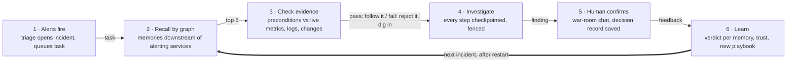

# Blast Radius: Final Implementation Plan (Track 02)

Oct 15, 2026 · @Genz IITIAN

> Live version (editable, with diagrams): https://claude.ai/code/artifact/85de3634-741b-49e4-9c9e-4d3f721a0514  
> Exported Oct 15, 2026. If this file and the live doc differ, the live doc wins.

## Pitch

**Blast Radius remembers previous incidents, checks whether that memory still applies, and shows how it changed the next investigation, even after a restart.**

Everything in this plan serves one claim, proved with our own measurements:

> Past experience changes the next investigation, survives restarts, and gets corrected when it is wrong.

The product: on-call agents that share one FalkorDB graph per company. They investigate simulated outages from observable evidence, turn each confirmed fix into a sourced playbook, recall it by graph proximity next time, verify its preconditions before trusting it, and remember what each engineer told them across sessions.

**Tracks to name on the form:** Agent Memory and Coordination (primary). Track 01 is a valid second entry because the investigator's tools are multi-hop graph queries served over MCP; the rules say you may enter any or all tracks but must name each one. Whether one project can win more than one prize is not stated, so ask in the FalkorDB Discord before submitting.

**Status (Oct 15, 11:30 IST): scope frozen.** No new features. The third review round's spec fixes are folded into the sections below, and the build follows the **Final roadmap** just below.

## Final roadmap

Scope is frozen; the work now is building and verifying. Everything is aimed at one acceptance test, and nothing on the defer list starts until it passes.

**The acceptance test (Gate G2):**

1. One incident creates a sourced playbook.
2. The whole stack restarts (`docker compose down && up`).
3. A related incident, worded differently, recalls that playbook.
4. A worker is killed mid-investigation.
5. Its replacement finishes from the last checkpoint.
6. The responder applies the saved conditional preference and cites its source.
7. Exactly one notification exists for that incident.

Split: **A = graph, coordination, agents**; **B = simulator, eval, UI**. Solo: do A's items first each day, then B's.

### Thu Oct 15 — Gate G1: one incident, end to end

- [ ] (Both, by 1 PM) Repo; `docker-compose.yml` with the FalkorDB volume; seeding as an explicit command, no auto-reseed; stop/start persistence check
- [ ] (Both) Ask in the FalkorDB Discord whether one project can win more than one track
- [ ] (A) `key` on every node; indexes, then unique constraints; poll `db.constraints()` until all are `OPERATIONAL`
- [ ] (A) Run every coordination query in FalkorDB Browser: claim, fence guard, checkpoint, action, handoff, stuck sweep; plus a test where two threads race for one task
- [ ] (A) Test the A1 query, and whether `*0..2` works
- [ ] (B) Simulator with the DB-saturation family first; evidence tools over MCP; truth files; scenario clock
- [ ] (A) Deterministic triage (tasks born with `epoch: 0, attempts: 0`); investigator worker with synchronous checkpoints and `ok` / `already_done` / `lease_lost` outcomes
- [ ] (B) Responder: time-valid `who_to_page`; intent-keyed notification; oracle confirmation that writes the `Decision` and the `Learn` task
- [ ] **G1:** one DB-saturation incident runs alert → triage → investigator → responder → confirmed, every step in the graph, exactly one notification

### Fri Oct 16 — Gate G2: the acceptance test

- [ ] (A) `Decision` + `USED` edges; A1 and A1b recall; `bind_playbook_params`; precondition executor
- [ ] (A) `Learn` task → candidate playbook (JSON strings + `payload_hash`); A2 verdicts with idempotent feedback
- [ ] (B) Bad-deploy and cache families; the same-symptom pair
- [ ] (B) War-room chat: sessions, verbatim messages, conditional preference extraction with read-back; A3 with validation
- [ ] (B) 30 scenarios + the M5 scenario; eval runner with one graph per arm; arms A and C
- [ ] **G2:** the seven-step acceptance test passes twice in a row. If it isn't passing by midnight, Saturday morning finishes it before anything else

### Sat Oct 17 — Gate G3: proof and UI

- [ ] (A) Failure tests: stale-write rejection, `already_done` retries, stuck sweep, crash between confirmation and playbook creation
- [ ] (A) `bench/load.py` (1 and 2 worker pairs, 2 companies) and canary tests across results, history, caches and the UI stream
- [ ] (B) Arm B with the same machinery; recall@5 on frozen snapshots; uncached run for timings; charts; **numbers frozen by 9 PM**
- [ ] (B) UI: Memory Lens and timeline first; then chat and kill button; graph colours only if time
- [ ] (Both) Deploy, or confirm local setup from a clean clone
- [ ] **G3:** all six demo moments run from the UI; numbers frozen

### Sun Oct 18 — Submit

- [ ] Morning: README per the checklist, including AI-assistant disclosure; verify from a fresh clone
- [ ] Midday: record the video, two takes of moments 3–4
- [ ] Afternoon: bug fixes only; blog post if time
- [ ] By 8 PM IST: submit, naming each track (deadline 11:59 PM IST)

**Not in this build:** Librarian consolidation, graph animation, shared playbook library, more than 2 companies, Track 03 features. PageRank only as a tie-breaker, and only if it costs under an hour.

### Repo layout

```
blast-radius/
├── docker-compose.yml       # falkordb (with volume), sim, mcp, workers, web
├── memory/                  # recall, trust, facts, playbooks, consolidate (later)
│   └── queries/*.cypher     # every query the product depends on
├── coord/                   # claim, fence, checkpoint, actions, handoff, sweep
├── agents/                  # triage.py, investigator.py, responder.py
├── sim/                     # world seed, failure families, evidence generators
├── tools/                   # MCP server: evidence + graph tools
├── chat/                    # war-room sessions, preference extraction
├── eval/                    # scenarios, truth/ (hidden), arms, scorer, results/
├── bench/                   # load.py, isolation tests
├── web/                     # Memory Lens, timeline, graph panel, chat
└── README.md
```

## What changed after the two reviews

Both reviews were mostly right, and the ChatGPT review found real correctness bugs. The biggest change: **the agents now investigate observable evidence from a simulator**, not just topology, so the eval measures diagnosis instead of lookup.

| # | Finding | From | Decision | Where |
| --- | --- | --- | --- | --- |
| 1 | Topology alone can't show what actually failed; add a simulator with evidence tools and keep ground truth hidden | ChatGPT | **Accepted** (biggest change) | Simulator |
| 2 | Friday needs a playbook but only Saturday's Librarian makes one | ChatGPT | **Accepted:** responder writes a candidate playbook right after each confirmed fix | Learning loop, A4 |
| 3 | Lease claim ignores `attempts`, so poison tasks loop forever | Gemini | **Accepted** | Crash safety |
| 4 | Undirected 2-hop recall pulls in unrelated services through hubs | Gemini | **Accepted:** walk downstream only | A1 |
| 5 | `hits × decay(min distance)` overstates coverage; return paths | ChatGPT | **Accepted:** sum a contribution per alerting service | A1 |
| 6 | "Current" facts filtered only by `valid_to IS NULL` | ChatGPT | **Accepted:** filter on both bounds | A3 |
| 7 | Trust rewards every used playbook when the run succeeds | ChatGPT | **Accepted:** per-memory verdict (helped / misled / not applicable) | A2 |
| 8 | Feedback can apply twice after a retry | ChatGPT | **Accepted:** feedback events with stable IDs | A2 |
| 9 | "Retired within 3 uses" is false with the old priors (3/7 ≈ 0.43) | ChatGPT | **Accepted:** new priors, arithmetic checked | A2 |
| 10 | A3 creates one replacement per old fact; no `ABOUT` link | ChatGPT | **Accepted** | A3 |
| 11 | Valid-time facts don't show what the agent *knew* | ChatGPT | **Accepted:** immutable decision records | Schema |
| 12 | Replaying tool lists can repeat an obsolete diagnosis | ChatGPT | **Accepted:** playbooks get preconditions, expected observations, a stop rule | A4 |
| 13 | Batched step logs vanish on kill; stale workers can still write; actions can repeat | ChatGPT | **Accepted:** fencing tokens, synchronous checkpoints, idempotent actions | Crash safety |
| 14 | 30 s lease is longer than the demo segment | Both | **Accepted:** demo profile 6 s lease, 2 s heartbeat, disclosed on screen | Crash safety |
| 15 | Conversation history is the weakest Track 02 point | Both | **Accepted:** war-room chat with per-engineer memory; never cut | Conversation |
| 16 | Isolation must be tested with identical IDs, canaries, caches, UI streams | ChatGPT | **Accepted** | Tenants |
| 17 | Verify FalkorDB persistence and full-stack restart | ChatGPT | **Accepted** | Tenants |
| 18 | Eval needs held-out wording, related services, same-symptom-different-cause, no-memory cases | ChatGPT | **Accepted** | Evaluation |
| 19 | Kill button in the UI; colour the graph by hop | Gemini | **Accepted**, simple version (colours, no animation) | UI |
| 20 | WCC may chain unrelated incidents | Both | **Adapted:** group by confirmed failure signature first; WCC only if time | A5 |
| 21 | `*0..2` zero-length paths are supported | Gemini | **Adapted:** unverified; test Thursday, keep a two-query fallback | A1 |
| 22 | Use a fast model for the eval | Gemini | **Adapted:** fine, but the *same* model for every arm, plus response caching | Evaluation |
| 23 | Add PR / author nodes for Track 03 | Gemini | **Adapted:** `Change` nodes with authors are needed anyway as bad-deploy evidence; not targeting Track 03 | Simulator |
| 24 | Enter all three tracks | Gemini | **Declined:** Track 03 asks for docs, tickets and chats ingestion we won't build; name Tracks 02 and 01 only | Pitch |
| 25 | "Top 1%" / guaranteed win framing; claims about other entries | Gemini; ChatGPT flagged | **Declined / removed:** our measurements make the case, not predictions about other teams | Pitch kit |

**Third round (spec fixes, no new scope):**

| # | Finding | From | Decision |
| --- | --- | --- | --- |
| 26 | Arms B and C differ in more than retrieval, so a win can't be attributed | ChatGPT | **Accepted:** B gets the same records, trust rules, precondition executor and feedback; only retrieval differs; each arm runs in its own graph; recall@5 compared on the same snapshot |
| 27 | Handoff skips the lease-expiry check; `$now` captured before a long LLM call goes stale | ChatGPT | **Accepted:** one full guard everywhere; lease math uses database time inside each query |
| 28 | Two different clocks are mixed | ChatGPT | **Accepted:** database time for leases; scenario time for evidence, validity and `recorded_at` |
| 29 | Action key per recipient lets a retry page a second person | ChatGPT | **Accepted:** key by logical intent; recipient, channel and payload stored on the action |
| 30 | Successful retries return zero rows, which looks like a lost lease | ChatGPT | **Accepted:** explicit outcomes `ok` / `already_done` / `lease_lost` |
| 31 | Crash between confirmation and playbook creation loses the learning | ChatGPT | **Accepted:** confirmation creates a `Learn` task keyed by decision ID |
| 32 | A3 retires future-dated facts early, writes before validating, duplicates on retry | ChatGPT | **Accepted:** validity decides eligibility, validate first, `MERGE` by ID with payload check, unique constraints |
| 33 | Preferences need conditions (DB saturation → ticket, bad deploy → page) | ChatGPT | **Accepted:** condition in the lineage key and filter; extracted preference read back for confirmation |
| 34 | Retirement claim too broad; bad-deploy demo shows rejection, not trust loss | ChatGPT | **Accepted:** claim narrowed; M5 is a separate test |
| 35 | Ground-truth wording, cached latency, cold starts, kill timing, map storage, reseeding | ChatGPT | **Accepted** (each fixed in place) |
| 36 | Tasks created without `epoch: 0, attempts: 0` break the fence (`null + 1` is null) | Gemini | **Accepted** |
| 37 | Playbook parameters need binding, including with several alerting services | Gemini | **Accepted:** `bind_playbook_params` from the top-scoring path |
| 38 | `FOREACH` scope quirks | Gemini | **Adapted:** A3 no longer uses `FOREACH`; test every query Thursday |

## Scope

Narrower and deeper: one complete, correct learning loop beats five half-built features.

| Build first | Defer (only if time) |
| --- | --- |
| Investigator and responder as separate LLM workers | Four independent LLM agents |
| Deterministic triage (rules group alerts into an incident) | LLM triage reasoning |
| Simulator: 12–15 services, 3 failure families | 60 services, 6 families |
| Graph recall with visible paths and provenance | Ranking experiments |
| Confirmed incident → candidate playbook | Librarian consolidation (WCC/CDLP) |
| Per-memory verdicts and trust correction | Shared playbook library across companies |
| War-room chat that resumes across sessions | Time-travel slider (keep the decision records) |
| Durable checkpoints, fenced leases, takeover | Graph animation |
| Two tenants with isolation tests | Five large cloned companies |
| Memory Lens, agent timeline, measured results | Extra dashboards |

**Track 02 coverage:** every focus point has a feature, a demo moment and a test.

| Focus point | Feature | Demo moment | Test |
| --- | --- | --- | --- |
| Episodic, semantic, procedural memory | Incidents and checkpoints; time-valid facts; playbooks with preconditions | 2, 3, 5 | M1, M3, M5 |
| Persistent conversation history | War-room chat stored per engineer; resumes in a new session | 3 | M6 |
| Shared state and handoffs | Fenced tasks in the graph; investigator → responder | 1, 4 | M7 |
| High-concurrency reads and writes | Parallel incidents across tenants; short single-query writes | 6 | M8 |
| Separate memory per user or tenant | One graph per company; per-engineer preferences | 3, 6 | M9 |

## The learning loop

One complete loop, working end to end by Friday night, is the heart of the project: **investigate → confirm → create sourced memory → restart → recall → verify → improve or correct.**



Step 3 is what separates this from memory that is simply replayed: a recalled playbook is followed only if live evidence matches its preconditions, and step 6 lowers trust in any memory that misled the agent.

## Incident simulator

The graph tells the agent what *could* have failed; the simulator gives it evidence of what *did*. Without this, the eval would only test lookup.

**World (synthetic, seeded):** one food-delivery company of 12–15 services, e.g. `web-gateway`, `checkout-api`, `cart-svc`, `payments-gw`, `orders-svc`, `menu-svc`, `search-svc`, `auth-svc`, `notify-svc`, plus datastores `postgres-orders`, `postgres-payments`, `redis-cache`, `kafka-events`. A second company uses **identical service names and IDs** with different people and canary values, for isolation tests.

**Three failure families**, each designed so the symptom alone is ambiguous:

| Family | Root cause | Symptom users see | Evidence that tells it apart |
| --- | --- | --- | --- |
| DB saturation | Connection pool exhausted on a Postgres store | Checkout / payments timeouts | DB connections at max; slow-query log lines; no recent deploy |
| Bad deploy | A recent `Change` on one service | Checkout / payments timeouts or 5xx | Error spike starts at the deploy time; stack traces in that service's logs; DB healthy |
| Cache failure | `redis-cache` down or evicting | Slow search and menu | Cache hit rate collapses; DB load rises behind it |

DB saturation and bad deploy deliberately share symptoms: that is the **same-symptom, different-cause** case where a recalled playbook must be checked, not trusted blindly.

**Agent-visible evidence tools** (served over MCP, all read-only):

| Tool | Returns |
| --- | --- |
| `inspect_metrics(service, window)` | Latency, error rate, saturation metrics (DB connections, cache hit rate, CPU) as small time series |
| `inspect_logs(service, n)` | Templated log lines with noise and varied wording |
| `inspect_recent_changes(service, hours)` | `Change` nodes from the graph: what was deployed, when, by whom |
| `check_dependency_health(service)` | Health of each direct dependency |
| `find_upstream_candidates(alerting)` | Graph: shared downstream dependencies of the alerting services |
| `blast_radius(node)` | Graph: everything that depends on a node, with hops and customer-facing flag; PageRank as tie-breaker |
| `who_to_page(node, at)` | Graph: owner team and on-call valid at time `at`, plus the engineer's preferences |

**Ground truth stays out of reach until it is earned.** Each scenario's hidden answer (root node, family, correct owner at that time) lives only in `eval/truth/*.json`. Unrevealed labels are evaluator-only: never in FalkorDB, never in a prompt, never used by recall. After the agent submits a diagnosis, the "oracle engineer" script confirms or rejects it through the same feedback API the UI uses, and only that permitted confirmation becomes historical knowledge in the graph.

**Deterministic:** every scenario is generated from a seed, so the same scenario always produces the same evidence. Deploy events are written to the graph as `Change` nodes (`(:Person)-[:AUTHORED]->(:Change)-[:MODIFIED]->(:Service)`), because they are real company knowledge the agent should be able to traverse; which change was bad is not.

## Graph schema

One graph per company (`company_<id>`). Memory nodes are **versioned and never edited in content**: a change creates a new version that `SUPERSEDES` the old one, so any past decision can point at exactly what it used.

**Shared fields on every memory node** (`Fact`, `Playbook`), initialised at creation:

| Field | Purpose |
| --- | --- |
| `id` | Stable ID of this version |
| `lineage_id`, `version` | Same lineage across versions; version number |
| `source`, `approved_by` | seed / agent / human; who approved it (separate from observed results) |
| `valid_from`, `valid_to` | When it is true in the world (`valid_to` null = open-ended) |
| `recorded_at` | When the system learned it |
| `status` | active / retired / superseded |
| `helped`, `misled`, `prior_a`, `prior_b`, `trust` | Outcome counts, prior, and derived trust (A2) |

**Nodes**

| Node | Layer | Key properties |
| --- | --- | --- |
| `Service`, `Datastore` | World | name, kind, tier, customer\_facing |
| `Team`, `Person` | World | name, handle, channel |
| `Change` | World | id, kind (deploy / config), at, summary |
| `Alert` | Incident | id, signal, text, fired\_at |
| `Incident` | Incident (episodic) | id, opened\_at, resolved\_at, status, signature (set on confirm: family + root kind) |
| `Checkpoint` | Incident (episodic) | task\_id, epoch, n, tool, args\_json, observation, at |
| `Decision` | Incident (audit) | id, kind (root\_cause / page), value, at, agent, task\_id, epoch; **immutable** |
| `Feedback` | Incident | id (stable), verdict, by, at |
| `Fact` | Semantic memory | subject, predicate, object + shared fields |
| `Playbook` | Procedural memory | signature, applies\_to\_kind, params, preconditions, steps, expected, stop\_if + shared fields |
| `Session`, `Message` | Conversation | session id, started\_at; role, text, at |
| `Task` | Coordination | id, type, status, epoch, lease\_owner, lease\_until, attempts, created\_at |
| `Action` | Coordination | key (idempotency), kind (page / ticket), target, status, at |

**Edges**

| Edge | From → To | Notes |
| --- | --- | --- |
| `DEPENDS_ON` | Service → Service / Datastore | topology |
| `OWNED_BY`, `MEMBER_OF`, `ON_CALL` | as named | valid\_from, valid\_to |
| `AUTHORED`, `MODIFIED` | Person → Change → Service | deploy history |
| `FIRED_ON`, `TOUCHED` | Alert → Service; Incident → Service / Datastore | TOUCHED has role: alerting / root / impacted |
| `ABOUT` | Fact / Playbook → Service / Datastore / Person | where a memory applies |
| `LEARNED_FROM` | Fact / Playbook → Incident / Message | provenance |
| `SUPERSEDES` | new version → old version | memory updates without deletion |
| `USED` | Decision → Fact / Playbook | score, hops, path, trust\_at\_use, verdict (filled once by feedback) |
| `HAS_CHECKPOINT`, `FOR`, `NEXT` | Task → Checkpoint; Task → Incident; Task → Task | durable progress and handoffs |
| `EMITTED` | Task → Action | one logical action per key |
| `GAVE`, `ON` | Person → Feedback → Decision | who confirmed what |
| `WITH`, `IN`, `CONCERNS` | Session → Person; Message → Session; Session → Incident | conversation history |

**Indexes and unique constraints** (create on Thursday, before any worker starts). A unique constraint needs an exact-match index on the same property first, and is built asynchronously, so poll `CALL db.constraints()` until each one shows `OPERATIONAL` ([constraint docs](https://docs.falkordb.com/commands/graph.constraint-create)):

```bash
GRAPH.QUERY company_a "CREATE INDEX FOR (t:Task) ON (t.id)"
GRAPH.CONSTRAINT CREATE company_a UNIQUE NODE Task PROPERTIES 1 id
```

Unique: `Memory.id`, `Task.id`, `Decision.id`, `Action.key`, `Feedback.id`, `Checkpoint.cid` (= task\_id + ':' + n), `Session.id`, and `key` on world nodes. Plain indexes: `Service.name`, `Task.status`, `Task.type`, `Memory.lineage_id`, `Playbook.signature`, `Incident.status`.

**Storage rules:** FalkorDB can't store maps or nulls as property values ([data types](https://docs.falkordb.com/datatypes)). Store playbook `params`, `preconditions`, `steps`, `expected` and `conclusion` as validated JSON strings, plus a `payload_hash` used to detect conflicting retries. "No end date" means the property is absent, which reads as null. Every `Task` is created with `epoch: 0, attempts: 0`; otherwise `epoch + 1` evaluates to null and every fenced write silently fails.

**Preference facts are conditional:** `subject: person:priya`, `predicate: preferred_channel`, `condition_family: db_saturation`, `object: ticket`. The lineage key is subject + predicate + condition, so "bad deploy → page me" never supersedes "DB saturation → ticket".

**Decision records answer "what did the agent know?"** Each `Decision` is written once with `USED` edges to the exact memory versions, their scores, paths and trust at that moment. Valid-time filters answer "what was true then"; decision records answer "what the agent believed then."

**Two clocks, never mixed:** database time (`timestamp()` inside each query) for leases, heartbeats and recovery latency; simulated scenario time (`$scenario_now`) for evidence windows, `valid_from` / `valid_to`, `recorded_at` and recall eligibility. A memory learned while replaying a Tuesday scenario is recorded at Tuesday's scenario time, not today's wall clock.

## Memory algorithms

Five algorithms, each with one Cypher file in `memory/queries/`. Cypher fetches candidates; Python does the scoring, so formulas are easy to test. Give both memory types a shared `:Memory` label (`:Memory:Playbook`, `:Memory:Fact`) so queries can match either without a label scan.

### A1 — Graph recall (directed, with paths)

An alerting service fails because something it **depends on** failed, so walk downstream only. This stops hub services from pulling in unrelated memories.

```cypher
MATCH (a:Service) WHERE a.name IN $alerting
MATCH p = (a)-[:DEPENDS_ON*1..2]->(n)<-[:ABOUT]-(m:Memory)
WHERE m.status = 'active'
  AND m.recorded_at <= $scenario_now
  AND m.valid_from <= $scenario_now
  AND (m.valid_to IS NULL OR $scenario_now < m.valid_to)
RETURN m.id AS id, labels(m) AS kind, a.name AS alerting, n.key AS target,
       length(p) - 1 AS hops, [x IN nodes(p) | x.name] AS path,
       m.trust AS trust, m.recorded_at AS recorded_at
```

Run a 0-hop version too (memory pinned to the alerting service itself), unless `*0..2` works in your FalkorDB version; test that on Thursday. `recorded_at <= $now` matters in the eval: a replayed scenario must never see memory learned later.

**A1b — related services.** Also fetch active playbooks whose `applies_to_kind` matches the *kind* of a downstream node (e.g. any `postgres`), at half weight. This is how a playbook learned on `postgres-orders` can help with `postgres-payments`.

Score in Python, keeping the shortest path per (memory, alerting service), so every alerting service adds its own contribution:

```latex
\text{score}(m) = \text{trust}(m) \cdot w_{\text{kind}}(m) \cdot e^{-\text{age}(m)/30\,\text{days}} \cdot \sum_{a \in A} 0.5^{\,\text{hops}(a,m)}
```

where A is the set of alerting services that reach m, and w\_kind is 1 for an exact node match and 0.5 for a kind match. The top 5, with their paths, go to the investigator and the Memory Lens.

### A2 — Trust from per-memory verdicts

Each `USED` edge gets one verdict when the human (or eval oracle) confirms the root cause:

- **helped:** the agent followed the memory (its preconditions held) and its conclusion matched the confirmed cause
- **misled:** the agent followed it and its conclusion was wrong
- **not applicable:** a precondition failed, so the agent did not follow it; no trust change

```latex
\text{trust} = \frac{\text{helped} + \alpha}{\text{helped} + \text{misled} + \alpha + \beta}
```

Priors: agent-made α = 1, β = 1 (starts at 0.5); human-approved α = 2, β = 1 (starts at 0.67). **Retire when misled ≥ 2 and trust < 0.5.** What this guarantees, and no more: a playbook with **zero successes** retires on its second misleading use (1/4 = 0.25 agent-made, 2/5 = 0.40 human-approved). It is not a general two-strike rule: an agent-made playbook with 2 helped and 2 misled sits at exactly 0.5 and stays active until its record gets worse. Approval lives in `approved_by`, separate from observed counts.

A playbook rejected because a precondition failed gets *not applicable* and keeps its trust. Only a playbook that passes its preconditions and still points to the wrong cause counts as *misled*; M5 tests exactly that case.

Idempotent update: a retried feedback call changes nothing, because each `USED` verdict can be set only once.

```cypher
MERGE (f:Feedback {id: $feedback_id})
ON CREATE SET f.verdict = $overall, f.by = $by, f.at = $now
WITH f
MATCH (d:Decision {id: $decision_id})
MERGE (f)-[:ON]->(d)
WITH d
UNWIND $verdicts AS v
MATCH (d)-[u:USED]->(m:Memory {id: v.id})
WHERE u.verdict IS NULL
SET u.verdict = v.verdict,
    m.helped = m.helped + CASE WHEN v.verdict = 'helped' THEN 1 ELSE 0 END,
    m.misled = m.misled + CASE WHEN v.verdict = 'misled' THEN 1 ELSE 0 END
SET m.trust = (m.helped + m.prior_a) * 1.0 / (m.helped + m.misled + m.prior_a + m.prior_b)
SET m.status = CASE WHEN m.misled >= 2 AND m.trust < 0.5 THEN 'retired' ELSE m.status END
```

(Trust counters are statistics about a version, not its content, so updating them in place keeps the "versions are never edited" rule.)

### A3 — Supersede a fact (one replacement, scoped, sourced)

Validity decides which version is current; lifecycle `status` only ever changes to *retired*. That way a change scheduled for Friday doesn't hide today's fact early. The write is two steps.

**Step 1, validate (read-only):** look up the scope node, the source node (an `Incident` or `Message`, by `key`) and any existing memory with this `id`. In Python: if scope or source is missing, write nothing and return an error; if the `id` exists with the same `payload_hash`, return `already_done`; if it exists with a different hash, reject it as a conflict.

**Step 2, write (one query, safe to retry):**

```cypher
MATCH (scope {key: $scope_key}), (src {key: $source_key})
MERGE (new:Memory:Fact {id: $id})
ON CREATE SET new.lineage_id = $lineage, new.version = $version,
  new.subject = $s, new.predicate = $p, new.condition_family = $cond, new.object = $o,
  new.source = $source_kind, new.approved_by = $approver,
  new.valid_from = $valid_from, new.recorded_at = $scenario_now, new.status = 'active',
  new.helped = 0, new.misled = 0, new.prior_a = $a, new.prior_b = $b,
  new.trust = $a * 1.0 / ($a + $b), new.payload_hash = $hash
MERGE (new)-[:ABOUT]->(scope)
MERGE (new)-[:LEARNED_FROM]->(src)
WITH new
MATCH (old:Memory:Fact {lineage_id: $lineage})
WHERE old.id <> new.id AND old.status = 'active'
  AND (old.valid_to IS NULL OR old.valid_to > $valid_from)
SET old.valid_to = $valid_from
MERGE (new)-[:SUPERSEDES]->(old)
```

If there is no older version, the final `MATCH` finds nothing and the query simply ends after creating the new one; the outcome comes from step 1, not from returned rows. Give every world, incident and message node a `key` (e.g. `service:checkout-api`, `incident:104`, `message:7781`). The same close-and-open pattern applies to `OWNED_BY`, `MEMBER_OF` and `ON_CALL` edges. "Current" always means `valid_from <= scenario_now AND (valid_to IS NULL OR scenario_now < valid_to)`.

### A4 — Candidate playbook right after a confirmed fix

The responder writes it as soon as the root cause is confirmed, so learning does not wait for the Librarian. It is built from the confirmed run's checkpoints: keep the steps whose observations supported the confirmed cause, then replace concrete names with parameters.

```json
{
  "signature": "db_saturation:postgres",
  "applies_to_kind": "postgres",
  "params": ["db", "alerting"],
  "preconditions": [
    {"tool": "check_dependency_health", "args": {"service": "$alerting"}, "expect": {"dep": "$db", "healthy": false}},
    {"tool": "inspect_recent_changes", "args": {"service": "$alerting", "hours": 2}, "expect": {"count": 0}}
  ],
  "steps": [
    {"tool": "inspect_metrics", "args": {"service": "$db"}, "expect": {"metric": "db_connections_pct", "op": ">=", "value": 95}}
  ],
  "conclusion": {"root": "$db", "family": "db_saturation"},
  "stop_if": "any precondition or expected observation fails"
}
```

The investigator checks preconditions first with plain tool calls (no LLM needed). If any fail, it stops, marks the playbook *not applicable*, and investigates normally. That is the **same-symptom, different-cause** behaviour: a recent deploy fails the "no recent changes" precondition, so the old DB playbook is rejected on evidence. If everything holds, it proposes the conclusion after a few tool calls instead of a full LLM investigation; that is where the speed-up comes from.

Keep `expect` machine-checkable (field, operator, value) so the check is deterministic and testable.

**Parameter binding** (`bind_playbook_params`, about 10 lines): take the top-scoring recall match; bind `$alerting` to the first node of its path and the playbook's target parameter (e.g. `$db`) to the node it is pinned to. For a kind match (A1b), bind the target to the downstream node of `applies_to_kind` on that path. When several services alert, bind to the single highest-scoring (alerting, target) pair, so every tool call gets one service name.

**Durable learning:** the confirmation write also creates a `Learn` task with ID `learn:<decision_id>`, claimed and fenced like any other task. The candidate playbook's ID is derived from the decision ID, so if a worker dies between confirmation and playbook creation, the next worker creates it, and a retry finds it through `MERGE` instead of duplicating it.

### A5 — Librarian consolidation (deferred)

Only after the loop works: group active candidate playbooks by `signature`, merge each group into one version (preconditions from all, steps common to at least two), link it `LEARNED_FROM` every source incident, and `SUPERSEDES` the candidates. Grouping by confirmed signature is predictable; try `algo.WCC` only if signatures turn out too coarse, since WCC joins anything connected by a chain.

## Coordination and crash safety

FalkorDB makes each single query atomic and runs writes to one graph one at a time ([concurrency docs](https://docs.falkordb.com/design/concurrency)). That protects each write, not the whole agent workflow, so the app adds three rules: **fence every task write, checkpoint synchronously, and give every action a stable key.** The claim we make: *resumes from durable checkpoints without duplicate actions.*

**Workers:** triage is a deterministic function on alert ingest; investigator and responder are separate LLM worker processes; the Librarian is deferred. All communicate only through `Task` nodes.

**Task states:** `open` → `leased` → `done`; an expired lease returns to claimable; after 3 attempts a sweep marks it `stuck` and the UI flags it.

**1. Claim, with attempts limit and a new fencing epoch**

```cypher
MATCH (t:Task {type: $type})
WHERE (t.status = 'open' OR (t.status = 'leased' AND t.lease_until < timestamp()))
  AND t.attempts < 3
WITH t ORDER BY t.created_at LIMIT 1
SET t.status = 'leased', t.lease_owner = $instance,
    t.lease_until = timestamp() + $ttl_ms,
    t.attempts = t.attempts + 1, t.epoch = t.epoch + 1
RETURN t.id AS id, t.epoch AS epoch
```

Lease times always come from `timestamp()` inside the query (database time), never from a `$now` the worker captured before a long LLM call. Every `Task` is created with `epoch: 0, attempts: 0`.

Stuck sweep, run every few seconds:

```cypher
MATCH (t:Task) WHERE t.status = 'leased' AND t.lease_until < timestamp() AND t.attempts >= 3
SET t.status = 'stuck'
```

**2. Fence every task write.** Heartbeats, checkpoints, decisions, actions and handoffs all start with the same guard. If it returns 0 rows, the worker has lost its lease and must stop immediately, so a paused worker can never write after another one takes over.

```cypher
MATCH (t:Task {id: $task_id})
WHERE t.status = 'leased' AND t.epoch = $epoch
  AND t.lease_owner = $instance AND t.lease_until >= timestamp()
```

**3. Synchronous, idempotent checkpoints.** Write each step before starting the next; never buffer them in memory.

```cypher
// full fence guard above, then:
MERGE (c:Checkpoint {cid: $task_id + ':' + toString($n)})
ON CREATE SET c.task_id = $task_id, c.n = $n, c.epoch = $epoch, c.tool = $tool,
              c.args_json = $args, c.observation = $obs,
              c.at = timestamp(), c.scenario_at = $scenario_now
MERGE (t)-[:HAS_CHECKPOINT]->(c)
RETURN c.n
```

A worker that takes over reads all checkpoints for the task in order, passes them to its LLM as "work done so far", and continues at step n + 1. Read-only diagnostic calls may repeat after a crash; that is harmless.

**4. Idempotent actions, keyed by intent.** The key names *what* the action is for, not who receives it: `inc-104:initial-notification`; a deliberate escalation gets its own key (`inc-104:escalation-1`). Recipient, channel and payload are chosen once and stored on the action, so a retry or a takeover after an ownership change reuses them instead of notifying a second person. The pager is graph-backed for the hackathon, so "sending" is one atomic, fenced write that also reports whether it already happened:

```cypher
// full fence guard above, then:
MERGE (a:Action {key: $intent_key})
ON CREATE SET a.kind = $kind, a.recipient = $recipient, a.channel = $channel,
              a.payload = $payload_json, a.status = 'pending', a.created_at = timestamp()
MERGE (t)-[:EMITTED]->(a)
WITH a, a.status AS before
SET a.status = 'sent', a.sent_at = coalesce(a.sent_at, timestamp())
RETURN a.key AS key, before, a.recipient AS recipient, a.channel AS channel
```

`before = 'pending'` means it was sent now (`ok`); `before = 'sent'` means `already_done`, and the stored recipient is returned.

If a real Slack or Discord webhook is added later, send the same key with it and drop repeats on the receiving side.

**5. Fenced, idempotent handoff.** The next task's ID is derived from the current one, so a retried handoff finds it instead of creating a second.

```cypher
MATCH (t:Task {id: $task_id})-[:FOR]->(i:Incident)
WHERE t.status = 'leased' AND t.epoch = $epoch
  AND t.lease_owner = $instance AND t.lease_until >= timestamp()
SET t.status = 'done'
MERGE (n:Task {id: $task_id + ':next'})
ON CREATE SET n.type = $next_type, n.status = 'open', n.epoch = 0,
              n.attempts = 0, n.created_at = timestamp()
MERGE (t)-[:NEXT]->(n)
MERGE (n)-[:FOR]->(i)
RETURN n.id
```

**Explicit outcomes.** Every coordination call returns `ok`, `already_done` or `lease_lost`, so a successful retry never looks like a fencing failure. If the fenced write returns a row: `ok`. If it returns none, re-read the task: if it is `done` with a `NEXT` task (or the action is already `sent`), return `already_done` with the existing result; otherwise return `lease_lost`, and the worker stops at once.

**Timing profiles:** normal 30 s lease / 10 s heartbeat; **demo 6 s lease / 2 s heartbeat**, with a small "demo timing" label on screen so the shorter setting is disclosed.

## Conversation memory: the war room

Persistent conversation history is an explicit Track 02 focus point, so it is built in the core, never cut. The on-call engineer talks to the responder in a small war-room chat; what they say becomes memory that changes the next incident, even after every process restarts.

**How it works**

1. Every chat opens a `Session` linked to the engineer (`WITH`) and the incident (`CONCERNS`); each turn is a `Message` (`IN`), stored verbatim.
2. After each engineer message, the responder extracts instructions as **conditional** preference facts: subject, predicate, `condition_family`, object, e.g. `person:priya` / `preferred_channel` / `db_saturation` / `ticket`. The condition is part of the lineage key, so "bad deploy → page me" sits beside "DB saturation → ticket" instead of replacing it.
3. **Read-back for approval:** the responder replies "Saved: for DB saturation, open a ticket instead of Slack, with raw slow-query lines. Correct?" A confirmed extraction gets `source = human_approved` and the human prior; an unconfirmed one stays `agent_extracted` with the agent prior. Both link `LEARNED_FROM` the exact message, so the human's own words and the system's reading of them stay distinct.
4. When a new session starts, the responder loads that person's active preferences whose condition matches the current incident's family (or that have no condition), plus the last few messages from their earlier sessions, filtered by person and by company.
5. When it applies a preference, it says where it came from.

**Demo exchange**

- *Session 1 (incident 104):* Priya: "For DB saturation, don't ping me on Slack. Open a ticket and paste the raw slow-query lines, not a summary."
- *Full stack restart.*
- *Session 2 (incident 117, same family, different wording):* the responder opens a ticket instead of paging on Slack, includes the raw lines, and writes: "Per your note in incident 104, I opened a ticket and attached the raw slow-query lines." Priya asks "where did we leave 104?" and gets a summary built from the stored messages and checkpoints.

**Tests (M6):** scripted sessions with a restart in between; pass if the preference is applied in the new session and its source message is cited. Isolation check: an engineer with the same handle in company B never receives company A's preferences or messages.

## Tenants, concurrency and persistence

Isolation is enforced in code and proved by tests; concurrency is measured small and honest; persistence is configured and verified, not assumed.

**Tenant isolation**

- One graph per company: `company_a`, `company_b`. Different companies' writes never queue behind each other, because FalkorDB serializes writes per graph.
- The graph name comes only from trusted server context (the task envelope or the authenticated UI session). No tool accepts a graph name as an argument, so the LLM cannot change it.
- Both companies use **identical service names and IDs**, and each seeds unique canary values (e.g. a fact `canary = A-7f3e` vs `B-91c2`). Any appearance of the other company's canary anywhere is a failure.
- Check every path data can leak through, not just query results: recall results, conversation history, any in-process caches (keyed by company), LLM response caches, and the UI's live event stream.

**Concurrency (small benchmark, `bench/load.py`)**

1. Two companies; 1, 2 and 4 investigator + responder worker pairs per company.
2. Fire 20 incidents across both companies at once, with the eval oracle confirming.
3. Record p50 / p95 latency of memory reads and writes, incidents per minute, duplicate logical actions, rejected stale (fenced) writes, and takeovers.
4. Pass: 0 duplicate actions, 0 canary leaks. Takeovers and rejected stale writes are expected and reported, not failures.

Keep writes short (one small query per step) and LLM calls *between* writes, never holding anything open across them.

**Persistence**

Mount a named volume at FalkorDB's data directory, as in the [persistence guide](https://docs.falkordb.com/operations/durability/persistence):

```bash
docker volume create falkordb_data
docker run -d --name falkordb -v falkordb_data:/var/lib/falkordb/data -p 6379:6379 falkordb/falkordb
```

In `docker-compose.yml`, use the same volume mapping. Make seeding a separate, explicit command and turn off any automatic reseed on startup; otherwise a restart test can pass simply because the data was recreated. Verify twice: restart only the agent workers (worker independence), then `docker compose down && docker compose up` and check that an incident, a preference, a checkpoint and a playbook **created after the initial seed** are all still there. The second test is filmed in demo moment 3. Review the RDB and AOF options linked from that guide and set them explicitly rather than relying on defaults.

## Evaluation

The eval answers four questions: does memory help, does *graph* memory help more than text memory, does the agent know when memory doesn't apply, and is coordination correct. Results describe this 30-scenario synthetic benchmark only; say so in the README.

**Test set: 30 scenarios, replayed in time order so memory builds up naturally**

| Category | Count | What it tests |
| --- | --- | --- |
| Cold start | 6 (2 per family) | Each run on an **empty memory snapshot**, so nothing can be recalled, even through a kind match |
| Repeat, new wording | 6 | Same service and family; alert and log wording from templates never used earlier |
| Related service | 6 | Same family on a sibling of the same kind (e.g. `postgres-payments` after `postgres-orders`) |
| Same symptom, different cause | 6 | Symptoms match an old playbook, evidence contradicts it (expected verdict: not applicable) |
| No applicable memory | 3 | Novel cases; the agent should not force a memory |
| Org change | 3 | Ownership or on-call changes before the incident |

M5 uses its own seeded scenario: a wrong playbook whose preconditions *pass*, so it actually misleads the investigation.

**Arms**, identical in model, temperature (0), tools, topology, tool-call budget and context budget; only memory access differs:

| Component | A: no memory | B: text retrieval | C: graph retrieval |
| --- | --- | --- | --- |
| Memory records and metadata | None | Same as C | Same as B |
| Validity and trust rules | n/a | Same | Same |
| Precondition executor | n/a | Same | Same |
| Feedback and learning | n/a | Same | Same |
| Retrieval | n/a | Embedding similarity of alert text to memory text, top 5 | A1 / A1b graph proximity, top 5 |

Only retrieval differs between B and C, so any gap is attributable to retrieval. Each arm runs in **its own graph** (`eval_a`, `eval_b`, `eval_c`), so one arm's learning never leaks into another. Recall@5 (M2) is measured separately: both retrievers query the **same frozen historical snapshot** at each scenario, so differences in what each arm previously learned don't distort the comparison.

**Metrics**

| # | Metric | Arms | Expected / pass |
| --- | --- | --- | --- |
| M1 | Tool calls, LLM calls and seconds per incident on repeat and related cases, always shown beside accuracy | A vs C | Report as measured |
| M2 | Recall@5: is the relevant memory in the top 5 (relevance labels live only in `eval/`) | B vs C | Report as measured |
| M3 | Root-cause accuracy by category | A, B, C | Report as measured |
| M4 | Misleading memory rejected and correct cause still found; false application rate on novel cases | B vs C | Report as measured |
| M5 | Misleading uses before a wrong seeded playbook retires; stale-owner pages after org changes | C | 2; 0 |
| M6 | Conversation preference applied in a new session after restart, with its source cited | C | All pass |
| M7 | Duplicate logical actions; rejected stale writes; resumes without redoing checkpointed steps | C | 0; reported; all pass |
| M8 | p50 / p95 memory read and write latency; incidents per minute | C | Report as measured |
| M9 | Canary leaks between companies | C | 0 |

Also report tokens per incident and the cost of generating playbooks, so the speed-up is not hiding extra work elsewhere.

**Rules**

- Unrevealed scenario labels stay evaluator-only; after a diagnosis is submitted, the oracle's confirmation becomes historical knowledge, exactly as a human confirmation would.
- Replay uses scenario time for `recorded_at` and recall eligibility, so no memory appears to come from the future.
- Use one fast, inexpensive model for all eval arms and name it in the README. Cache LLM responses by (arm, scenario, prompt hash) for quick reruns of **accuracy**, but measure **latency and speed-up from an uncached run**; cached timings never support the headline speed claim. If the demo uses a different model, say so on screen.
- If time allows, run 3 wording seeds and report the range, not just the best run.
- Report every number, including any metric where arm A or B wins. Results describe this benchmark only.

## UI and demo script

Two panels carry the story; everything else is support. Build them first on Saturday.

**Must-have panels**

- **Memory Lens:** for each incident, every memory considered, including rejected ones. Each row answers four questions: *what* was recalled; *why* it applied (path, hops, trust at use); *what evidence* supported or contradicted it (each precondition, pass or fail, with the observed value); *what changed afterwards* (verdict, trust before → after, new version).
- **Agent timeline:** tasks, claims, checkpoints and handoffs in order, with worker badges (active / dead) and the fencing epoch.

**Supporting pieces**

- Graph panel (Cytoscape.js): alerting services red, 1 hop orange, 2 hops yellow, memory badges with trust on their nodes. Static colours, no animation.
- War-room chat for the on-call engineer.
- "Kill investigator" button: the backend sends SIGKILL to that worker process; a lease countdown shows the takeover. Keep a terminal visible in a corner while recording so the real process exit is on screen.
- "Break a service" scenario picker and a results tab with the eval charts.

**Demo script (3:00)**

| Time | Moment | What the judge sees |
| --- | --- | --- |
| 0:00–0:10 | Hook | "Our agents remember past incidents, check that memory still applies, and show how it changed the next investigation, even after a restart." |
| 0:10–0:40 | **1. First incident** | Break `postgres-orders`. Investigator checks metrics, logs and recent changes; graph lights up by hop; hands off to the responder. Priya confirms in the war room and says: "for DB saturation, open a ticket with the raw slow-query lines." The responder reads it back; she confirms. |
| 0:40–0:55 | **2. Memory is created** | A `Learn` task produces the candidate playbook: preconditions, expected observations, and a link to the incident it came from. |
| 0:55–1:35 | **3. Restart, then a related outage** | `docker compose down && up` (sped up). Fresh session. `postgres-payments` saturates, alerts in new wording. Memory Lens: playbook recalled by kind match, preconditions passing one by one. **After checkpoint 3, press Kill**, mid-investigation. |
| 1:35–2:00 | **4. Takeover** | Badge goes dead; 6 s lease countdown; a second worker resumes at step 4 and finishes. Responder applies Priya's conditional preference and cites incident 104. Pager log: **exactly one ticket** for this incident. |
| 2:00–2:30 | **5. Memory that doesn't apply** | Same checkout timeouts, caused by a bad deploy. Memory Lens: DB playbook *rejected*, precondition failed ("deploy 12 min ago"), verdict *not applicable*, trust unchanged. Correct cause found. Ownership changed last week, so the current owner is notified. |
| 2:30–3:00 | **6. Proof** | Eval tables and charts (M1–M4), the M5 retirement result, counters for duplicate actions, stale writes and canary leaks (M7, M9), and the one command to rerun it all. |

## Submission checklist and pitch kit

Every item below comes from the [official rules](https://www.wemakedevs.org/hackathons/falkordb/rules); missing any of them can sink a strong project.

- [ ] Public source-code repository
- [ ] README with setup instructions and the graph data model
- [ ] The Cypher queries and graph algorithms the product depends on (link `memory/queries/` and `coord/`)
- [ ] Demo video showing the working project
- [ ] Live deployment, or complete local setup instructions
- [ ] Every track you are entering, named on the form
- [ ] AI coding assistant use disclosed (which tools, for what)
- [ ] Only synthetic or permitted data in the graph
- [ ] Main coding done during the event (Oct 15, 12:01 AM – Oct 18, 11:59 PM IST)
- [ ] Every team member can explain the graph model, the queries, the architecture and the main decisions

The last point matters: the rules say fully AI-generated projects without real understanding may be rejected. Before recording, each person should be able to walk through A1–A4 and the fencing guard without notes.

**One-liner:** Blast Radius remembers previous incidents, checks whether that memory still applies, and shows how it changed the next investigation, even after a restart.

**README order:** one-liner → 60-second GIF (moments 3 and 5) → results with measured numbers → how memory works (learning-loop diagram, A1–A4) → crash safety → graph model → queries → setup → limits and what didn't work → AI-assistant disclosure.

**Results headline template** (fill only with measured numbers): *"On our 30-scenario benchmark, graph memory reached \[X\]% root-cause accuracy vs \[Y\]% with no memory and \[Z\]% with text memory, rejected \[N\] of 6 misleading playbooks on evidence, and sent 0 duplicate pages across \[K\] forced worker kills."*

**Likely judge questions**

| Question | Answer to have ready |
| --- | --- |
| Why not a vector store? | Arm B is exactly that, given the same memories and budget; M2–M4 show where each wins. |
| How do you stop memory from making things worse? | Preconditions are checked before a playbook is trusted; per-memory verdicts lower trust; a deliberately wrong, zero-success playbook retires after two misleading uses, and established playbooks follow the documented threshold (M5). |
| What if a worker dies mid-incident? | Fenced leases, synchronous checkpoints and keyed actions: the next worker continues from the last checkpoint, and the stale one can't write (M7). |
| How is tenant data kept apart? | One graph per company chosen from server context, never by the LLM; canary tests across results, history, caches and the UI stream (M9). |
| Is the data real? | Synthetic and seeded, so every result is reproducible with one command; ground truth is hidden from the agents. |
| Did you use libraries or AI tools? | Yes, as allowed and disclosed; the memory model, coordination protocol and eval are our own design, and we can walk through each query. |

## Risks, cuts and sources

If Thursday's end-to-end incident slips past Friday noon, cut to one failure family plus the misleading case and keep everything else.

| Risk | Fallback |
| --- | --- |
| Simulator takes longer than planned | Two families (DB saturation, bad deploy); they alone produce the same-symptom case |
| Repeat runs aren't faster | Check the precondition executor runs without the LLM; if still flat, report it and lead with M4 (judgment) instead of speed |
| Graph recall loses to text memory on some category | Report it; explain why in the blog; optionally try graph candidates with text re-ranking as a fourth arm |
| A Cypher feature isn't supported (`*0..2`, `//` comments, a `MERGE` pattern) | Each query has a unit test from Thursday; fall back to two simpler queries |
| LLM rate limits during eval | Response cache; cut to 18 scenarios (3 per category) |
| UI eats Saturday | Memory Lens and timeline only; graph panel can be a FalkorDB Browser recording |

**Cut in this order:** Librarian (A5) → 3 wording seeds → arm B's extra variants → graph panel colouring → 4-worker benchmark (keep 1 and 2).

**Never cut:** the simulator's same-symptom case, preconditions, per-memory verdicts, fenced leases with the kill demo, conversation resume across restart, canary isolation tests, the eval table.

**Sources**

- [Graph Hacks rules](https://www.wemakedevs.org/hackathons/falkordb/rules) (submission requirements, tracks, AI disclosure, deadline)
- Event page pasted into the conversation (Track 02 focus points, prizes)
- [FalkorDB concurrency model](https://docs.falkordb.com/design/concurrency)
- [FalkorDB persistence in Docker](https://docs.falkordb.com/operations/durability/persistence)
- [FalkorDB algorithms overview](https://docs.falkordb.com/algorithms)
- Reviews pasted into the conversation from Gemini and ChatGPT
